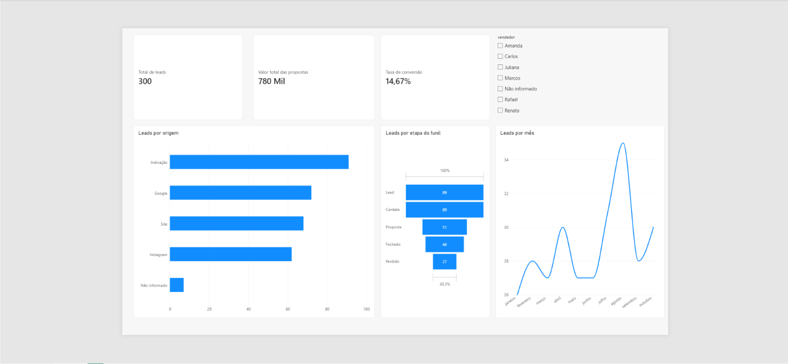

# painel_comercial_leads.pbix

Projeto prático de qualidade de dados e análise comercial, feito do zero com dados fictícios.

## O que eu fiz

1. Gerei uma base de 300 leads fictícios com erros propositais (campos vazios, valores escritos como texto, "A combinar", datas fora do esperado)
2. Limpei os dados no Google Sheets, mantendo a aba original (Dados brutos) e a tratada (Dados limpos)
3. Documentei cada decisão no Log de correções
4. Montei um painel no Power BI com os indicadores principais

## Indicadores do painel

- Total de leads e valor total das propostas
- Taxa de conversão (leads fechados / total)
- Leads por origem
- Leads por etapa do funil
- Leads por mês, com filtro por vendedor

## Decisões de qualidade de dados

- Campos de texto vazios (nome, origem, vendedor): preenchi com "Não informado"
- Valores de proposta vazios, zerados ou "A combinar": deixei em branco, para não distorcer médias e somas
- Valores escritos como texto ("R$ 9500", "3100 reais"): converti para número
- Datas: a base tem datas até dezembro de 2026, depois da data de criação do projeto. Mantive os dados e limitei o gráfico mensal até outubro.

## O que aprendi

- Uma coluna de valor com texto no meio ("R$ 9500", "3100 reais") impede o Power BI de somar, precisa ser tudo bem detalhado e com apenas uma formatação, número com número, texto com texto
- No projeto havia um lead a mais (301) por conta de uma linha em branco e isso pode acabar afetando na visualização do projeto
- A data futura que eu só fui descobrir depois de montar o painel e olhar o gráfico e por isso ajustei o log
- Também coloquei os dados brutos em uma aba separada, pra poder comparar com os dados tratados

## Ferramentas

Google Sheets, Power BI Desktop
